# 松间牌室 UI：方案与实现

这次改动统一大厅、等候房、牌桌、结算、回放和提示面板的松绿/暖白/金色视觉体系；以共用工具栏、按钮、弹窗和手牌布局保持各页面一致。

## 交互与布局

- 左上返回，右上规则与更多操作；辅助操作靠左，金色主要操作靠右。手机横屏辅助在上、确认在下。
- 手机手牌超过 8 张优先分排；按实际容器宽度、花色边界和对子/三条边界计算容量。窄屏/取底后牌多时增加排数。
- 每排左对齐，整手牌共用由最长一排确定的露出步距，短排右侧留白，不单独拉伸。无横向手牌滚动。
- 同一张牌在变换排数时保留 DOM 节点与键盘焦点；旋转和调整窗口不清空选牌。选中上移 12px，行间预留空间。
- 阶段操作独立占位，提示不遮住出牌按钮。长出牌按座位区域缩放，点击或键盘打开完整牌面弹窗。
- 保留 4/5/6 人、亮主/反主记录、庄家看底、机器人设置、房主控制、上一轮、回放、结算、加入与接管等功能；未修改引擎、协议或连接实现。
- PWA 允许任意方向，不再用遮罩阻止竖屏；保留浏览器缩放。

## 验证

- `pnpm typecheck`：所有包通过。
- `pnpm --filter @shengji/web build`：通过，含 PWA 构建。
- Node 24 下 `node node_modules/vitest/vitest.mjs run`：14 个测试文件、100 项测试通过（85 引擎 + 11 服务端 + 4 新增布局测试）。
- 布局测试遍历 1–38 张与 7 种宽度，检查顺序、唯一牌、每行容量、最小露出宽度、短排间距以及空手牌。
- 真实应用操作：创建房间、补齐机器人、发牌亮主、提示/跟牌、5 人庄家选择并提交 7 张扣底、叫朋友、看底牌、亮主记录、结算、回放及查看所有起手牌。
- 浏览器视口：390×844 竖屏、844×390 横屏与默认桌面。真实 4 人 25 张 / 6 人 26 张为双排，5 人取底 38 张为三排；实测 `scrollWidth === clientWidth`。旋转后选牌数量保持不变。横屏操作区下沿 364px，小于 390px；38 张竖屏操作区下沿约 819px，小于 844px。

截图中的多人牌局来自真实规则引擎和本地 WebSocket 服务：为稳定覆盖阶段，使用固定种子先通过 `applyAction` 推进到合法状态，再由浏览器正常加入机器人座位。不是修改 DOM、伪造 PlayerView 或静态原型冒充正式功能。试验数据不含线上玩家、真实会话或凭据。

本机 Node 20 不支持现有 `.ts` 搜索 worker，默认测试会失败；切换到项目 Dockerfile 使用的 Node 24 后全部通过。这不是此次 UI 引入的问题。此前独立的断线重连修复分支不包含在本 PR，主分支已有连接行为与服务端重连测试被保留。

## 本地复现阶段

安装依赖并构建后，在 Node 24 环境运行：

```sh
pnpm --filter @shengji/web build
SEARCH_WORKERS=0 node scripts/ui-preview.ts
```

该工具只监听 127.0.0.1，不读写快照。浏览器输入任意测试昵称后，用预填房间码加入：

| 地址 | 场景 |
| --- | --- |
| http://127.0.0.1:4320/?room=FOUR | 4 人 25 张初始手牌 |
| http://127.0.0.1:4321/?room=FIVE | 5 人庄家 38 张取底手牌 |
| http://127.0.0.1:4322/?room=SIXA | 6 人 26 张手牌 |
| http://127.0.0.1:4323/?room=SIXB | 独立的 6 人横屏房间 |
| http://127.0.0.1:4324/?room=DONE | 真实引擎结算与完整回放 |
| http://127.0.0.1:4325/?room=DECL | 亮主记录 |

对手暂停以方便检查，自己的操作仍走原有协议和引擎校验；正常游戏请使用 `pnpm start`。

## 方案预览（设计参考）

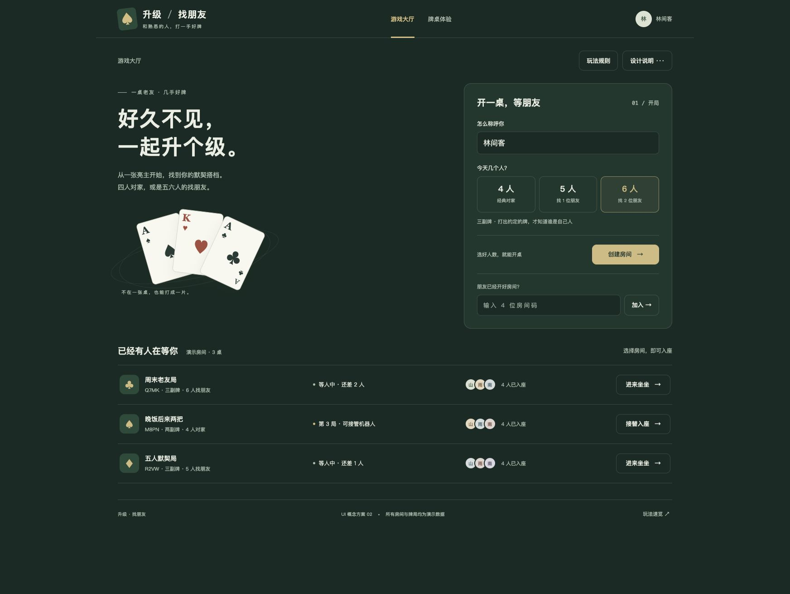
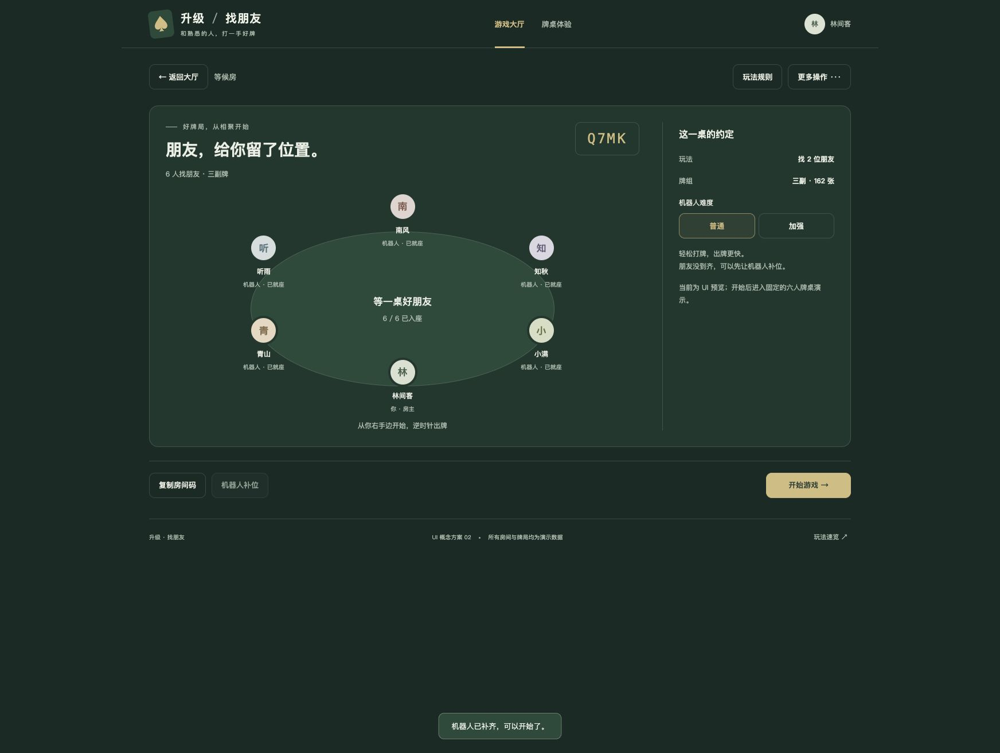
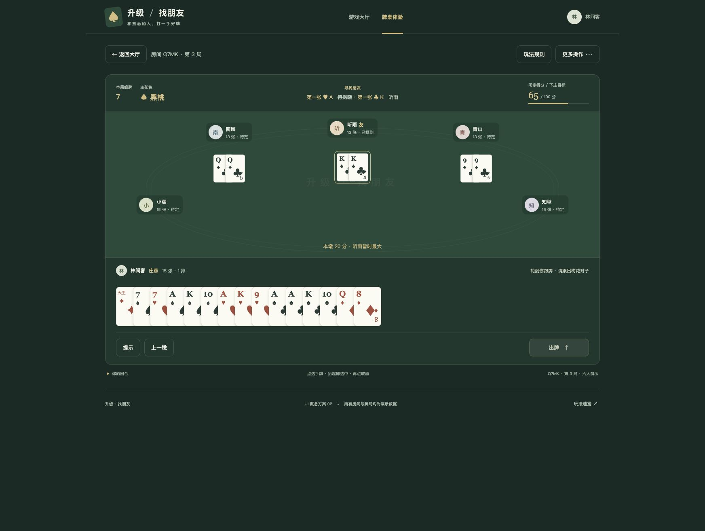


## 实际应用截图

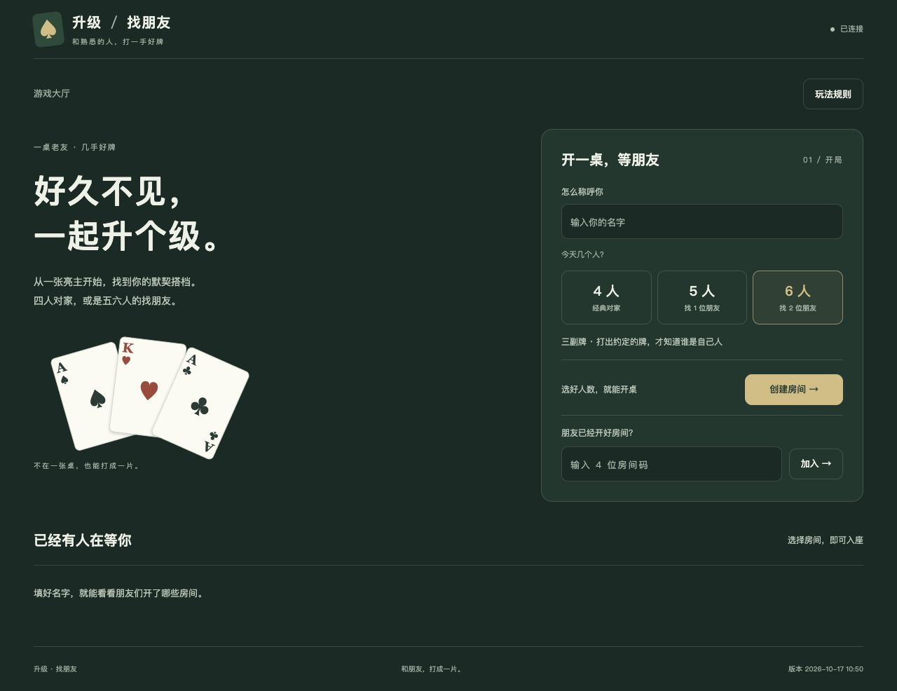
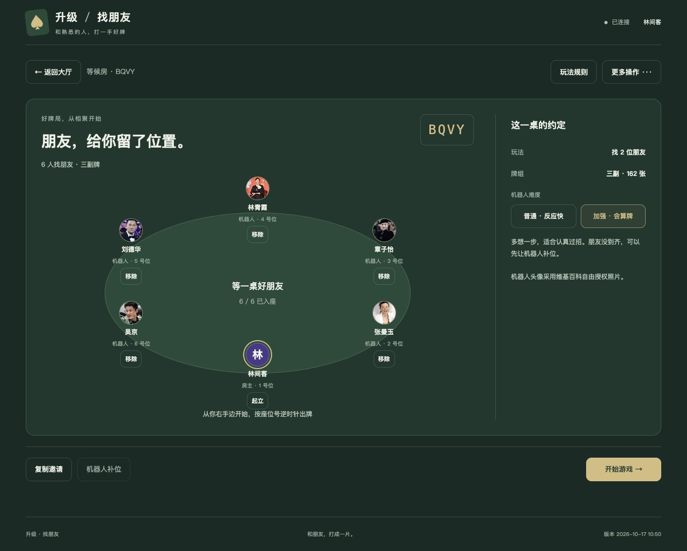
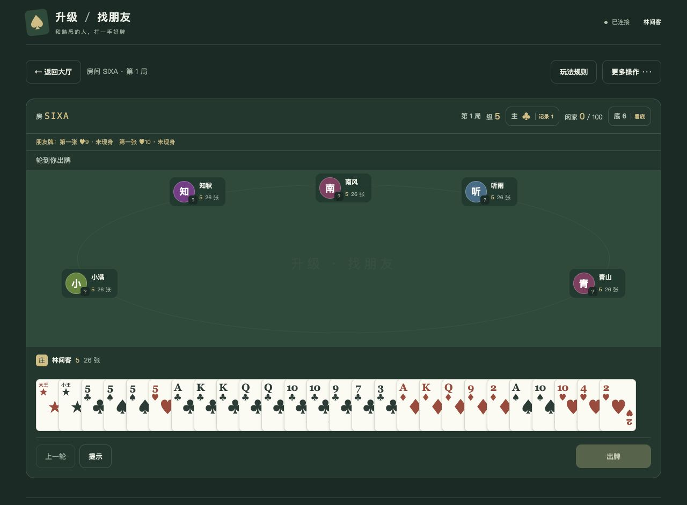

| 手机 26 张双排 | 庄家取底 38 张三排 |
| --- | --- |
| 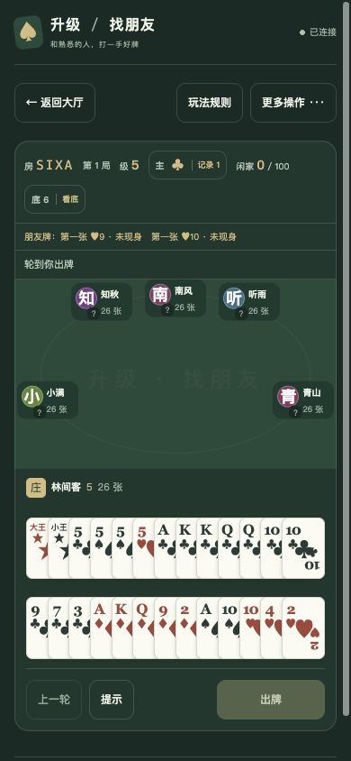 | 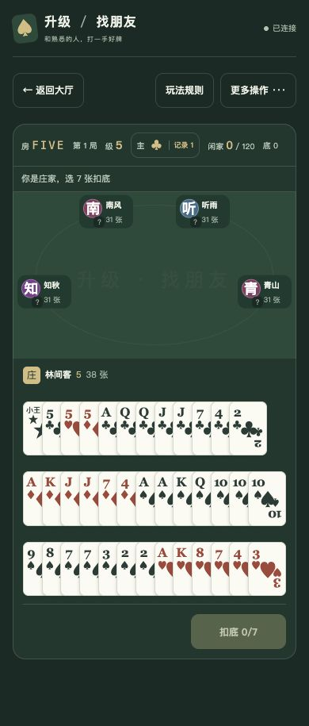 |

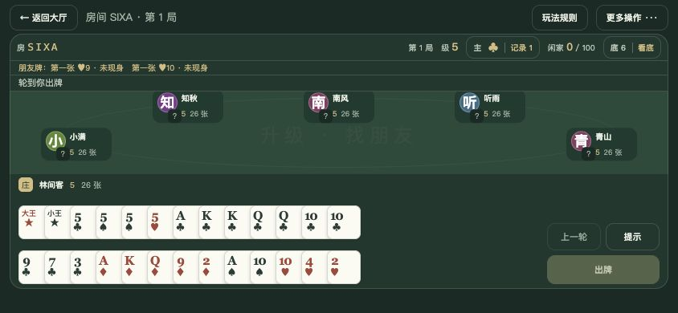

| 结算 | 回放 |
| --- | --- |
| 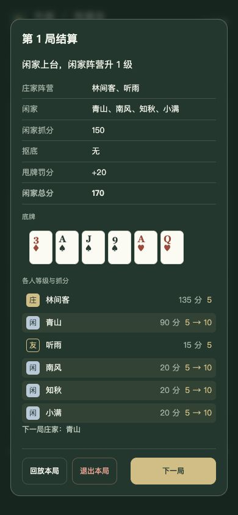 | 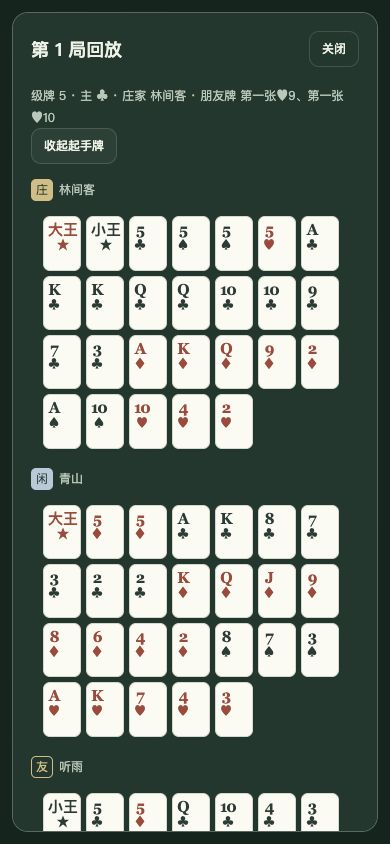 |
